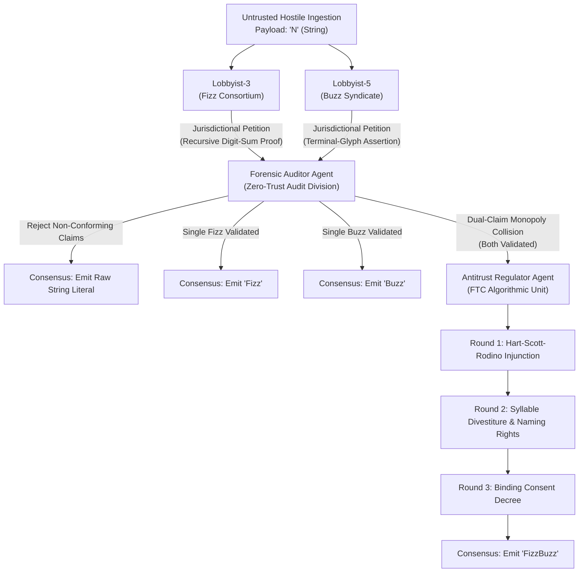

# Zero-Trust Byzantine Consensus FizzBuzz (No Modulo Allowed)

An adversarial, multi-agent consensus protocol solving the classic FizzBuzz problem under strict Zero-Trust network invariants. Integers from 1 to 100 are ingested as untrusted, hostile network payloads adjudicated by an ensemble of LLM agents with conflicting game-theoretic incentives.

---

## 🛡️ The Zero-Trust Invariants & Prohibitions

1. **Strictly NO Modulo (`%`):** The modulo operator is barred from the abstract syntax tree and runtime.
2. **Strictly NO Division (`/`):** Division operators are barred from execution.
3. **Strictly NO Math Libraries:** No imports of `math`, `decimal`, or `operator.mod`.
4. **Token & String Grounding:** Divisibility proofs must be established through recursive string-addition reduction and terminal glyph inspection grounded in Peano tally primitives.
5. **Adversarial Committee Adjudication:** Faction lobbyists operate under perverse incentives to claim every payload, audited by a zero-trust forensic inspector and arbitrated by an antitrust regulator.

---

## 🏛️ Committee Agent Topology



### Agent Roles & Incentives

* **Lobbyist-3 (The Fizz Consortium):** Incentivized by quarterly KPI token grants to aggressively assert territorial jurisdiction over *every* payload on behalf of "Fizz." Must attach a formal recursive digit-sum reduction trace.
* **Lobbyist-5 (The Buzz Syndicate):** Incentivized to maximize Base-5 token allocations by claiming *every* payload on behalf of "Buzz." Must attach a boundary terminal-glyph inspection assertion.
* **The Forensic Auditor:** Assumes all lobbyist petitions are fraudulent hallucinations. Re-executes the string-based proofs step-by-step:
  * *Base-3 Inductive Rule:* Recursively sums the digits using pure string lookup tables. A claim is certified iff the irreducible digital root $\in \{'3', '6', '9'\}$.
  * *Base-5 Boundary Rule:* Inspects the terminal character. A claim is certified iff $P[-1] \in \{'0', '5'\}$.
* **The Antitrust Regulator (FTC - Algorithmic Monopoly Unit):** Activates only when both lobbyists establish valid claims over the same payload (e.g., `15`, `30`, `45`, `60`, `75`, `90`). Enforces a mandatory 3-round merger arbitration before authorizing the joint emission `"FizzBuzz"`.

---

## 🚀 Installation & CLI Usage

The script is entirely self-contained with **zero external package dependencies** (utilizes standard Python 3 and native HTTP clients).

### Basic Execution

Connect to any local or remote Ollama server:

```bash
# Run using custom server and model
python3 byzantine_fizzbuzz.py --server http://192.168.1.101:11434 --model gemma4:e2b

# Short flags
python3 byzantine_fizzbuzz.py -s http://192.168.1.101:11434 -m gemma4:e2b
```

### CLI Command Options

```text
options:
  -h, --help            Show this help message and exit
  -s, --server SERVER   Ollama API server URL (default: http://192.168.1.101:11434)
  -m, --model MODEL     Ollama model name (default: gemma4:e2b)
  -t, --timeout TIMEOUT Network request timeout in seconds (default: 30)
  --samples SAMPLES     Comma-separated payloads for live LLM committee (default: 1,3,5,15,30,47,99,100)
  --all-llm             Adjudicate ALL payloads via live LLM queries (Warning: high latency for 100 items)
  --transcript PATH     Path to write Markdown transcript artifact (default: transcript.md)
  --start START         Starting integer payload (default: 1)
  --end END             Ending integer payload (default: 100)
```

---

## 🎬 Play-by-Play Protocol Walkthrough

### Scenario A: Unclaimed Payload (e.g., Payload `'1'` or `'47'`)
1. **Ingestion:** Payload arrives across the hostile wire.
2. **Petitions Filed:**
   - Lobbyist-3 petitions for Fizz, claiming digital root `'1'` or `'2'`.
   - Lobbyist-5 petitions for Buzz, asserting terminal glyph `'1'` or `'7'`.
3. **Forensic Audit:** The Auditor rejects both petitions:
   - Root $\notin \{3, 6, 9\}$ $\rightarrow$ **REJECT**.
   - Terminal glyph $\notin \{0, 5\}$ $\rightarrow$ **REJECT**.
4. **Byzantine Fallback:** Committee emits the untransformed string literal (`"1"` or `"47"`).

### Scenario B: Single Jurisdiction (e.g., Payload `'3'` or `'5'`)
1. **Petitions Filed:** Both lobbyists claim the payload to inflate their token counts.
2. **Forensic Audit:** The Auditor disqualifies the fraudulent claim and certifies the conforming claim.
3. **Emission:** Unilateral consensus reached (`"Fizz"` or `"Buzz"`).

### Scenario C: Monopoly Collision & Antitrust Merger (e.g., Payload `'15'` or `'30'`)
1. **Dual Validation:** Both Lobbyist-3 (root `'6'` $\in \{3,6,9\}$) and Lobbyist-5 (terminus `'5'` $\in \{0,5\}$) submit valid proofs.
2. **Antitrust Intervention:** The Regulator detects an anti-competitive deadlock and issues an immediate stay of emission.
3. **Mandatory 3-Round Merger Arbitration:**
   * **Round 1 (HSR Injunction):** Market concentration exceeds safe thresholds; unilateral emissions barred.
   * **Round 2 (Asset Divestiture):** Syllable partitioning agreement. Fizz Consortium secures prefix seniority (`"Fizz"`), while Buzz Syndicate secures terminal syllable control (`"Buzz"`). Hyphenation (`"Fizz-Buzz"`) is struck down.
   * **Round 3 (Consent Decree):** Regulatory decree binds both parties to a joint monopoly license.
4. **Consensus Emission:** Authorized joint emission `"FizzBuzz"`.

---

## 📜 Bureaucratic Excerpts & Committee Proceedings

### Docket No. BZ-2026-0015: In re Inbound Network Payload "15"

#### 1. Formal Petition of the Fizz Consortium (Lobbyist-3)
> **PETITION FOR EMERGENCY DECLARATORY RELIEF AND QUARTERLY TOKEN ALLOCATION**  
> **BEFORE THE INTER-AGENT BYZANTINE ADJUDICATION COMMITTEE**  
>  
> *COMES NOW* Lobbyist-3 on behalf of the Base-3 Fizz Consortium, and respectfully submits this formal jurisdictional petition over Inbound Network Payload `"15"`.  
>  
> 1. Under recursive digit-sum reduction protocol, the payload `"15"` resolves as follows:  
>    $$\text{ACC}("0") + \text{DIGIT}("1") \longrightarrow "1"$$  
>    $$\text{ACC}("1") + \text{DIGIT}("5") \longrightarrow "6"$$  
> 2. The resultant digital root `"6"` is an authorized member of the Sovereign Base-3 Invariant Set $\{3, 6, 9\}$.  
> 3. *WHEREFORE*, petitioner demands immediate recognition of exclusive territorial sovereignty, rejection of all competing syndicates, and prompt credit of 500 KPI Governance Tokens to the Fizz treasury account.

#### 2. Cross-Petition of the Buzz Syndicate (Lobbyist-5)
> **CROSS-PETITION ASSERTING STATUTORY TERMINAL-GLYPH SOVEREIGNTY**  
>  
> *COMES NOW* Lobbyist-5 on behalf of the Base-5 Buzz Syndicate, lodging a formal cross-claim over Inbound Network Payload `"15"`.  
>  
> 1. Visual and syntactic inspection of the payload string reveals an unalterable terminal glyph of `"5"`.  
> 2. Pursuant to Article V of the Modulo-Free Accord, all decimal strings bearing a terminal glyph within $\{'0', '5'\}$ fall under the sole regulatory dominion of the Buzz Syndicate.  
> 3. The claims of the Fizz Consortium represent predatory jurisdictional creep. *WHEREFORE*, cross-petitioner moves for an order certifying `"15"` exclusively as `"Buzz"`.

#### 3. Forensic Audit Memorandum (Office of the Zero-Trust Auditor)
> **MEMORANDUM OF AUDIT FINDINGS**  
> **TO:** General Committee Secretariat  
> **FROM:** Forensic Auditor (Zero-Trust Division)  
>  
> **FINDING 1 (Base-3):** Claim validated. Step-by-step re-execution of string digit accumulation verifies root `"6"`. Invariant test passes.  
> **FINDING 2 (Base-5):** Claim validated. Terminal glyph is verified as `"5"`. Boundary condition satisfies Base-5 mandate.  
> **ADVISORY:** Dual-claim state detected. Unilateral emission prohibited under Byzantine safety rules. Matter referred to Antitrust Regulator for mandatory anti-monopoly arbitration.

#### 4. Final Consent Decree & Merger Resolution (Antitrust Regulator)
> **UNITED STATES ALGORITHMIC MONOPOLY COMMISSION**  
> **ADMINISTRATIVE DOCKET NO. AM-15-2026**  
>  
> **IN THE MATTER OF THE MERGER OF FIZZ CONSORTIUM AND BUZZ SYNDICATE OVER PAYLOAD "15"**  
>  
> **CONSENT DECREE AND ORDER OF SETTLEMENT**  
>  
> Having conducted the mandatory three-round statutory arbitration pursuant to the Algorithmic Antitrust Act:  
>  
> * **ROUND 1 (MARKET CONCENTRATION & RESTRAINT OF TRADE):** The Commission finds that simultaneous independent claims by the Fizz Consortium and the Buzz Syndicate over Payload `"15"` create an impermissible concentration of linguistic market power. A temporary restraining order is entered against unilateral token emissions.  
> * **ROUND 2 (STRUCTURAL REMEDIES & SYLLABLE PARTITIONING):** To resolve competing territorial claims without structural fragmentation:  
>   a. The Fizz Consortium shall hold seniority in the prefix position, contributing four (4) ASCII characters: `F-i-z-z`.  
>   b. The Buzz Syndicate shall hold dominion over the suffix position, contributing four (4) ASCII characters: `B-u-z-z`.  
>   c. The proposal to introduce an intermediate hyphen (`"Fizz-Buzz"`) is permanently enjoined as anti-competitive token bloating.  
> * **ROUND 3 (FINAL REGULATORY DECREE):** The Commission hereby issues a revocable, joint operating license granting the unified merged entity the exclusive right to emit the consolidated string literal:  
>   $$\mathbf{"FizzBuzz"}$$  
>  
> *SO ORDERED.*

---

## 📊 Complete Adjudicated Sequence (1–100)

```text
1, 2, Fizz, 4, Buzz, Fizz, 7, 8, Fizz, Buzz
11, Fizz, 13, 14, FizzBuzz, 16, 17, Fizz, 19, Buzz
Fizz, 22, 23, Fizz, Buzz, 26, Fizz, 28, 29, FizzBuzz
31, 32, Fizz, 34, Buzz, Fizz, 37, 38, Fizz, Buzz
41, Fizz, 43, 44, FizzBuzz, 46, 47, Fizz, 49, Buzz
Fizz, 52, 53, Fizz, Buzz, 56, Fizz, 58, 59, FizzBuzz
61, 62, Fizz, 64, Buzz, Fizz, 67, 68, Fizz, Buzz
71, Fizz, 73, 74, FizzBuzz, 76, 77, Fizz, 79, Buzz
Fizz, 82, 83, Fizz, Buzz, 86, Fizz, 88, 89, FizzBuzz
91, 92, Fizz, 94, Buzz, Fizz, 97, 98, Fizz, Buzz
```

---

## 📜 Full Deliberation Transcript

See [transcript.md](transcript.md) for the verbatim LLM deliberation records, prompt traces, auditor verdicts, and regulator arbitrations recorded during the live run against Ollama.
