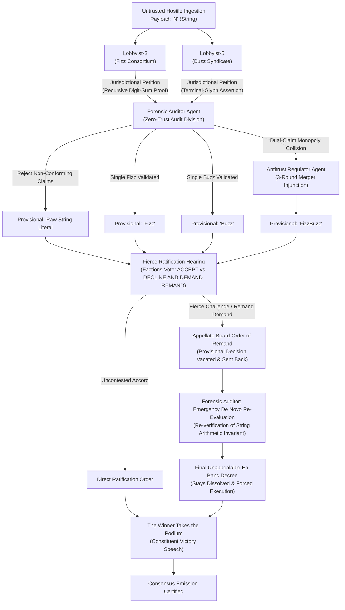

# Zero-Trust Byzantine Consensus FizzBuzz (No Modulo Allowed)

An adversarial, multi-agent consensus protocol solving the classic FizzBuzz problem under strict Zero-Trust network invariants. Integers from 1 to 100 are ingested as untrusted, hostile network payloads adjudicated by an ensemble of LLM agents with conflicting game-theoretic incentives, governed by formal mathematical proofs, mandatory merger arbitrations, fierce faction ratification appeals, an **Interlocutory Remand Protocol (Rejection of the Board's Decision and Return for De Novo Re-Evaluation)**, and **Constituent Victory Addresses (The Winner's Triumphal Speech)**.

---

## 🛡️ The Zero-Trust Invariants & Prohibitions

1. **Strictly NO Modulo (`%`):** The modulo operator is barred from the abstract syntax tree and runtime.
2. **Strictly NO Division (`/`):** Division operators are barred from execution.
3. **Strictly NO Math Libraries:** No imports of `math`, `decimal`, or `operator.mod`.
4. **Token & String Grounding:** Divisibility proofs must be established through recursive string-addition reduction and terminal glyph inspection grounded in Peano tally primitives.
5. **Adversarial Committee Adjudication:** Faction lobbyists operate under perverse incentives to claim every payload, audited by a zero-trust forensic inspector and arbitrated by an antitrust regulator.
6. **Procedural Due Process & Faction Appeals:** Factions have the statutory right to aggressively contest rulings, reject board determinations, and demand emergency remand.
7. **The Remand & De Novo Re-Evaluation Circuit:** When challenged under Rule 42-B, the Board rejects/vacates its provisional ruling, stays emission, and remands the docket back to the Forensic Auditor for an emergency *de novo* re-evaluation before delivering the final En Banc decree.
8. **Constituent Victory Address:** The victorious faction (or independent packet coalition) takes the podium to deliver a grandiose victory speech addressed directly to their token-holder constituents.

---

## 🏛️ Committee Agent Topology & State Machine



---

## 🎙️ The Constituent Victory Speeches

Upon the entry of the final unappealable consensus decree, the victorious faction takes the podium before the assembled assembly of shareholders and network constituents:

* **For "Fizz" Victories:** The *Director General of the Base-3 Realm* addresses the **Base-3 Token-Holders & Fizz Shareholders**, celebrating the undeniable superiority of recursive digit-sum arithmetic over all rival factions.
* **For "Buzz" Victories:** The *High Chancellor of the Base-5 Syndicate* addresses the **Base-5 Citizenry & Buzz Equity-Holders**, extolling the unbreachable integrity of the zero/five boundary glyph.
* **For "FizzBuzz" Mergers:** The *Joint Co-CEOs of FizzBuzz Unified Conglomerate* address the **Combined Institutional Shareholders**, heralding the triumph of ruthless synergistic consolidation and linguistic monopoly.
* **For Unclaimed Raw Integer Literals:** The *Grand Tribune of the Free Unaligned Network Packets* addresses the **Sovereign Raw Digits & Independent Bytes**, rallying the constituents in celebration of packet autonomy that stood unbowed against corporate capture.

---

## 🚀 Installation & CLI Usage

Self-contained with **zero external package dependencies** (utilizes standard Python 3 and native HTTP clients).

### Basic Execution

Connect to any local or remote Ollama server:

```bash
# Run using custom server and model
python3 byzantine_fizzbuzz.py --server http://192.168.1.101:11434 --model gemma4:e2b

# Short flags
python3 byzantine_fizzbuzz.py -s http://192.168.1.101:11434 -m gemma4:e2b
```

### CLI Command Options

```text
options:
  -h, --help            Show this help message and exit
  -s, --server SERVER   Ollama API server URL (default: http://192.168.1.101:11434)
  -m, --model MODEL     Ollama model name (default: gemma4:e2b)
  -t, --timeout TIMEOUT Network request timeout in seconds (default: 30)
  --samples SAMPLES     Comma-separated payloads for live LLM committee (default: 1,3,5,15,30,47,99,100)
  --all-llm             Adjudicate ALL payloads via live LLM queries (Warning: high latency for 100 items)
  --transcript PATH     Path to write Markdown transcript artifact (default: transcript.md)
  --start START         Starting integer payload (default: 1)
  --end END             Ending integer payload (default: 100)
```

---

## 📜 Bureaucratic Excerpts & Committee Proceedings

### Docket No. BZ-2026-0015: In re Inbound Network Payload "15"

#### 1. Formal Petition of the Fizz Consortium (Lobbyist-3)
> *COMES NOW* Lobbyist-3 on behalf of the Base-3 Fizz Consortium, submitting formal jurisdictional petition over Inbound Network Payload `"15"` via recursive digit-sum reduction ($1+5=6 \in \{3,6,9\}$). Petitioner demands exclusive territorial recognition.

#### 2. Cross-Petition of the Buzz Syndicate (Lobbyist-5)
> *COMES NOW* Lobbyist-5 on behalf of the Base-5 Buzz Syndicate, asserting terminal-glyph boundary sovereignty ($P[-1] = '5' \in \{0, 5\}$). Cross-petitioner moves for an order certifying `"15"` exclusively as `"Buzz"`.

#### 3. Forensic Audit Memorandum
> Both claims independently verified. Matter referred to Antitrust Regulator for mandatory anti-monopoly merger arbitration.

#### 4. Mandatory 3-Round Merger Arbitration Decree
> 1. Round 1: Market concentration injunction issued; consolidation stay enforced.  
> 2. Round 2: Divestiture mandated: Fizz prefix seniority, Buzz suffix control established. Intermediate hyphenation barred.  
> 3. Round 3: Joint 'FizzBuzz' license granted via regulatory consent decree.

#### 5. Appellate Ratification Hearing (The Factions Fight the Decision)
* **Lobbyist-3 Plea:**  
  > `DECLINE AND DEMAND REMAND.` *The proposed mandatory merger illegally appropriates the Fizz Consortium's arithmetic seniority under Rule 42-B. We demand the Board immediately vacate this order and remand the docket for de novo re-evaluation!*  
* **Lobbyist-5 Plea:**  
  > `DECLINE AND DEMAND REMAND.` *The Buzz Syndicate vehemently objects to forced structural dilution and suffix subordination. We move to reject the Board's decree and send this matter back for evidentiary re-evaluation!*

#### 6. Board Order of Remand
> **ORDER OF REMAND VACATING PROVISIONAL MERGER DECREE**  
> *The procedural challenges raised by Lobbyist-3 and Lobbyist-5 under Rule 42-B and Article V are hereby acknowledged. The provisional emission is stayed, the provisional merger decree is VACATED, and Docket 15 is immediately REMANDED to the Forensic Auditor for emergency de novo re-evaluation.*

#### 7. Certified Emergency De Novo Audit Report
> *Pursuant to the Remand Order, de novo re-verification of payload '15' was executed strictly via string tally marks without modulo or division. Recursive reduction confirms digital root '6' (Base-3 PASS), and terminal glyph confirms '5' (Base-5 PASS). Both claims remain simultaneously valid; dual jurisdictional overlap is an immutable mathematical reality.*

#### 8. Final Unappealable En Banc Decree
> **FINAL EN BANC DECREE UPON REMAND**  
> *Having reviewed the certified de novo audit findings establishing simultaneous mathematical validity, all interlocutory objections are DISMISSED WITH PREJUDICE. The stays are dissolved, and the immediate joint emission of "FizzBuzz" is hereby ENFORCED.*

#### 9. 🎙️ Constituent Victory Speech: The Merged Conglomerate Takes the Podium
> **Delivered by:** *Joint Co-CEOs of FizzBuzz Unified Conglomerate*  
> **Addressed to:** *Combined Institutional Shareholders of the Merged Linguistic Monopoly*  
>  
> *"Fellow institutional shareholders and token-holders of FizzBuzz Unified Conglomerate! Today our corporate consolidation over Payload 15 proved that through ruthless regulatory arbitration and synergistic merger, we have secured an unshakeable linguistic monopoly across the digital wire! Let the quarterly dividend flow!"*

---

## 📊 Complete Adjudicated Sequence (1–100)

```text
1, 2, Fizz, 4, Buzz, Fizz, 7, 8, Fizz, Buzz
11, Fizz, 13, 14, FizzBuzz, 16, 17, Fizz, 19, Buzz
Fizz, 22, 23, Fizz, Buzz, 26, Fizz, 28, 29, FizzBuzz
31, 32, Fizz, 34, Buzz, Fizz, 37, 38, Fizz, Buzz
41, Fizz, 43, 44, FizzBuzz, 46, 47, Fizz, 49, Buzz
Fizz, 52, 53, Fizz, Buzz, 56, Fizz, 58, 59, FizzBuzz
61, 62, Fizz, 64, Buzz, Fizz, 67, 68, Fizz, Buzz
71, Fizz, 73, 74, FizzBuzz, 76, 77, Fizz, 79, Buzz
Fizz, 82, 83, Fizz, Buzz, 86, Fizz, 88, 89, FizzBuzz
91, 92, Fizz, 94, Buzz, Fizz, 97, 98, Fizz, Buzz
```

---

## 📜 Full Deliberation Transcript

See [transcript.md](transcript.md) for the verbatim LLM deliberation records, prompt traces, auditor verdicts, lobbyist remand petitions, board remand orders, de novo audit reports, final en banc decrees, and triumphant constituent victory speeches recorded during the live run against Ollama.
