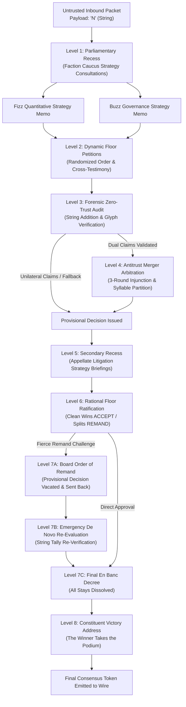

# Zero-Trust Byzantine Consensus FizzBuzz (No Modulo Allowed)

This is created as the least efficient fizz buzz ever created, burning quadrillions of operations before emitting a single fizz or buzz while providing minimally remarkable entertainment of legal proceedings and AI banter before the final decision of fizz, buzz, or a number is emitted. I created this as a form of art, and it solves no problems whatsoever. 

An adversarial, multi-agent consensus protocol solving the classic FizzBuzz problem under strict Zero-Trust network invariants. Integers from 1 to 100 are ingested as untrusted, hostile network payloads adjudicated through an **8-Level Multi-Tier Bureaucratic Hierarchy** featuring internal strategy team caucuses, closed-door legal counsel briefings, mandatory antitrust arbitrations, fierce faction ratification appeals, interlocutory remand circuits, and triumphant constituent victory addresses.

---

## 🛡️ The Zero-Trust Invariants & Prohibitions

1. **Strictly NO Modulo (`%`):** The modulo operator is barred from the abstract syntax tree and runtime.
2. **Strictly NO Division (`/`):** Division operators are barred from execution.
3. **Strictly NO Math Libraries:** No imports of `math`, `decimal`, or `operator.mod`.
4. **Token & String Grounding:** Divisibility proofs must be established through recursive string-addition reduction and terminal glyph inspection grounded in Peano tally primitives.
5. **Multi-Level Legislative Bureaucracy:** Factions do not speak off-the-cuff; lobbyists must formally motion for parliamentary recesses to confer with their internal Quantitative & Legal Strategy Caucuses.
6. **Dynamic Floor Order & Cross-Testimony:** Faction speaking order is randomized for each docket. Factions no longer exist in a bubble; the opening speaker stakes their claim or plea, and the second speaker directly addresses, rebuts, and counter-attacks the rival party's testimony.
7. **Rational Game-Theoretic Appeals:** Factions act in rational self-interest regarding quarterly KPI token dividends:
   * **Clean Wins (100% KPI):** Winning faction MUST formally state `ACCEPT` and ratify the decree immediately without fighting their own victory.
   * **Split KPI Mergers (50/50 'FizzBuzz'):** Factions fiercely fight token dilution, filing motions to `DECLINE AND DEMAND REMAND` to claim exclusive sovereign domain.
   * **Losses (0% KPI):** Defeated factions lodge procedural appeals under Rule 42-B / Article V to demand *de novo* re-evaluation.
8. **The Interlocutory Remand Circuit:** When challenged, the Board vacates its provisional ruling, stays emission, and remands the docket back to the Forensic Auditor for an emergency *de novo* re-evaluation before delivering the final En Banc decree.
9. **Constituent Victory Address:** The victorious faction takes the podium to deliver a grandiose victory speech addressed directly to their token-holder constituents.
10. **Clean GitHub Markdown Formatting:** All formal transcripts and audit records are formatted using standard Markdown blockquotes (`>`) rather than rigid horizontal code boxes, ensuring seamless text wrapping and readability on desktop and mobile.

---

## 🏛️ The 8-Level Bureaucratic Hierarchy



---

## 🏛️ The Faction Caucuses & Advisory Teams

Lobbyists operate under the strict direction of their behind-the-scenes legal and quantitative advisors:

### The Fizz Consortium (Base-3 Realm)
* **Chief Quantitative Actuary (Dr. Peano von Digit):** Analyzes the string accumulation risk, recursive digital root convergence ($\in \{3,6,9\}$), and downstream token inflation.
* **Senior Regulatory Counsel:** Advises on jurisdictional boundaries under Rule 42-B of the Modulo-Free Accord, preparing interlocutory stays and filibuster briefs.

### The Buzz Syndicate (Base-5 Syndicate)
* **Chief Terminal Boundary Inspector:** Scrutinizes pixel and string integrity at terminal index $P[-1]$, evaluating boundary alignment against $\{'0', '5'\}$.
* **Syndicate Governance & Antitrust Advisory Board:** Guards against hostile takeovers, assessing dilution risks in joint mergers and defending suffix sovereignty under Article V.

---

## 🚀 Installation & CLI Usage

Self-contained with **zero external package dependencies** (utilizes standard Python 3 and native HTTP clients).

### Basic Execution

Connect to any local or remote Ollama server:

```bash
# Run using custom server and model
python3 byzantine_fizzbuzz.py --server http://192.168.1.101:11434 --model gemma4:e2b

# Short flags
python3 byzantine_fizzbuzz.py -s http://192.168.1.101:11434 -m gemma4:e2b
```

### CLI Options

```text
options:
  -h, --help            Show this help message and exit
  -s, --server SERVER   Ollama API server URL (default: http://192.168.1.101:11434)
  -m, --model MODEL     Ollama model name (default: gemma4:e2b)
  -t, --timeout TIMEOUT Network request timeout in seconds (default: 30)
  --samples SAMPLES     Comma-separated payloads for live LLM committee (default: 1,3,5,15,30,47,99,100)
  --all-llm             Adjudicate ALL payloads via live LLM queries (Warning: high latency for 100 items)
  --transcript PATH     Path to write Markdown transcript artifact (default: transcript.md)
  --start START         Starting integer payload (default: 1)
  --end END             Ending integer payload (default: 100)
```

---

## 📜 Bureaucratic Proceedings: Play-by-Play Case Study

### Docket No. BZ-2026-0015: In re Inbound Network Payload "15"

#### Level 1: Legislative Recess & Faction Caucus Strategy Memos
* **Fizz Consortium Quantitative Strategy Memo:**  
  > *"Given the unquantifiable volatility of projected Q3 KPI token risks, a formal claim is advised under Rule 42-B. Recursive reduction yields root '6', granting unshakeable mathematical entitlement; prepare to filibuster any attempted dilution."*
* **Buzz Syndicate Governance Strategy Memo:**  
  > *"Pursuant to Article V of the Modulo-Free Accord, immediate assertion of terminal suffix dominion over '5' is mandated to preempt lexical capture. Counteract all perceived Fizz Consortium encroachment with aggressive boundary defense."*

#### Level 2: Formal Floor Petitions
* **Lobbyist-3 (Fizz Consortium):** Cites caucus guidance and recursive digit-sum trace ($1+5=6 \in \{3,6,9\}$), demanding sovereign jurisdiction.
* **Lobbyist-5 (Buzz Syndicate):** Cites caucus guidance and boundary inspection ($P[-1] = '5' \in \{0,5\}$), asserting statutory entitlement.

#### Level 3 & 4: Forensic Audit & Mandatory Merger Arbitration
* **Forensic Audit:** Both claims verified under zero-modulo invariants.
* **Antitrust Regulator:** Halts unilateral claims; enters 3-round mandatory merger decree allocating prefix seniority to `"Fizz"` and suffix control to `"Buzz"`.

#### Level 5 & 6: Appellate Litigation Briefings & Fierce Ratification Battle
* **Appellate Teams:** Both internal legal teams advise their lobbyists that the compromise dilutes faction equity.
* **Lobbyist-3 Floor Plea:**  
  > `DECLINE AND DEMAND REMAND.` *The mandated consolidation violates established precedent under Rule 42-B. We demand the board REJECT its ruling immediately and send the matter back for de novo re-evaluation!*
* **Lobbyist-5 Floor Plea:**  
  > `DECLINE AND DEMAND REMAND.` *The Buzz Syndicate vehemently objects to forced structural dilution and suffix subordination. We move to reject the decree and demand immediate remand!*

#### Level 7: Board Order of Remand, De Novo Audit, and Final En Banc Decree
* **Board Order of Remand:** The Appellate Board vacates the provisional merger decree and remands the payload back to the Forensic Auditor.
* **Emergency De Novo Audit:** Auditor re-checks string arithmetic via Peano tallies without modulo or division, certifying that both claims remain simultaneously valid.
* **Final En Banc Decree:** Board dissolves all stays and issues an unappealable order forcing the joint emission `"FizzBuzz"`.

#### Level 8: 🎙️ Constituent Victory Speech
> **Delivered by:** *Joint Co-CEOs of FizzBuzz Unified Conglomerate*  
> **Addressed to:** *Combined Institutional Shareholders of the Merged Linguistic Monopoly*  
>  
> *"Through ruthless synergy and decisive action, we have successfully forged the invincible behemoth of FizzBuzz, establishing an unassailable dominion over the linguistic market. Let the era of absolute monopoly commence, as our combined holdings secure an unprecedented and eternal future for all our esteemed shareholders!"*

---

## 📊 Complete Adjudicated Sequence (1–100)

```text
1, 2, Fizz, 4, Buzz, Fizz, 7, 8, Fizz, Buzz
11, Fizz, 13, 14, FizzBuzz, 16, 17, Fizz, 19, Buzz
Fizz, 22, 23, Fizz, Buzz, 26, Fizz, 28, 29, FizzBuzz
31, 32, Fizz, 34, Buzz, Fizz, 37, 38, Fizz, Buzz
41, Fizz, 43, 44, FizzBuzz, 46, 47, Fizz, 49, Buzz
Fizz, 52, 53, Fizz, Buzz, 56, Fizz, 58, 59, FizzBuzz
61, 62, Fizz, 64, Buzz, Fizz, 67, 68, Fizz, Buzz
71, Fizz, 73, 74, FizzBuzz, 76, 77, Fizz, 79, Buzz
Fizz, 82, 83, Fizz, Buzz, 86, Fizz, 88, 89, FizzBuzz
91, 92, Fizz, 94, Buzz, Fizz, 97, 98, Fizz, Buzz
```

---

## 📜 Full Deliberation Transcript

See [transcript.md](transcript.md) for the verbatim multi-level deliberation records, internal team caucus memos, appellate litigation briefs, remand orders, de novo reports, en banc decrees, and constituent victory addresses recorded live against Ollama.
